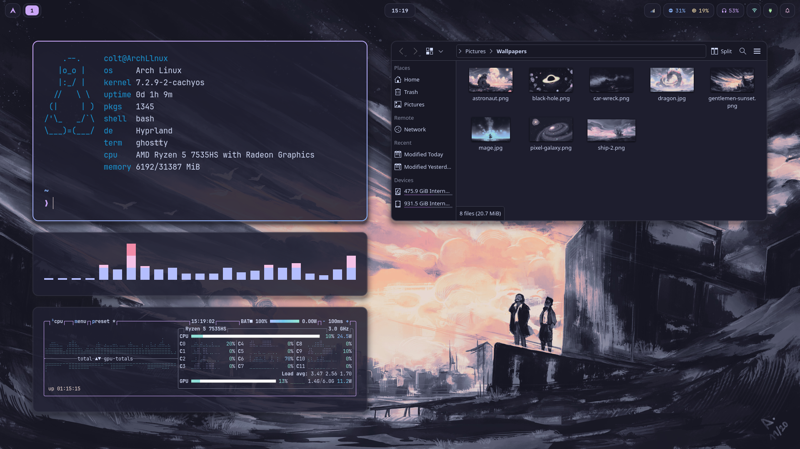
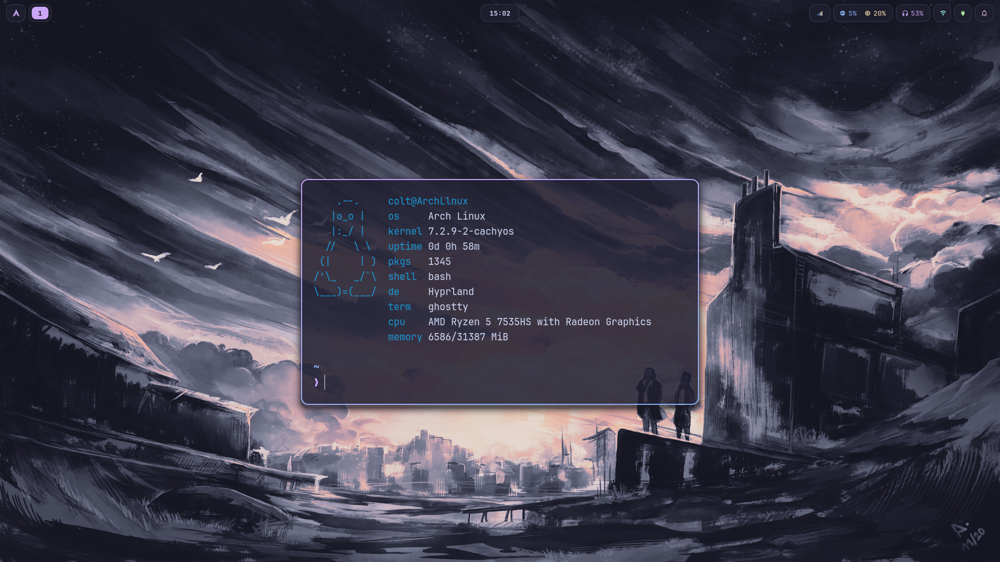

# dotfiles
My full Hyprland dotfiles




## Configs

- [bytefetch](https://github.com/ColtNovak/bytefetch)
- Hyprland and hyprlock
- Waybar
- swaync
- SwayOSD
- Ghostty
- fish
- starship
- btop
- cava


## Install

```
yay -S hyprland hyprlock hyprpolkitagent xdg-desktop-portal-hyprland waybar swaync swayosd \
    ghostty fish starship vicinae-bin awww grim slurp hyprpicker satty jq wl-clipboard \
    wl-clip-persist playerctl network-manager-applet power-profiles-daemon libnotify qt6ct \
    catppuccin-gtk-theme-mocha breeze-icons ttf-jetbrains-mono-nerd noto-fonts \
    eza bat zoxide fzf btop cava waypaper pwvucontrol dolphin bytefetch
```

If you stream with Sunshine, [hyprcurtain](https://github.com/ColtNovak/hyprcurtain) gets loaded automatically once it's installed (`yay -S hyprcurtain`).

Then clone the repo and run the install script:

```
git clone https://github.com/ColtNovak/dotfiles ~/dotfiles
~/dotfiles/install.sh
```

Wallpaper: gentlemen-sunset.png from [walls-catppuccin-mocha](https://github.com/orangci/walls-catppuccin-mocha)
